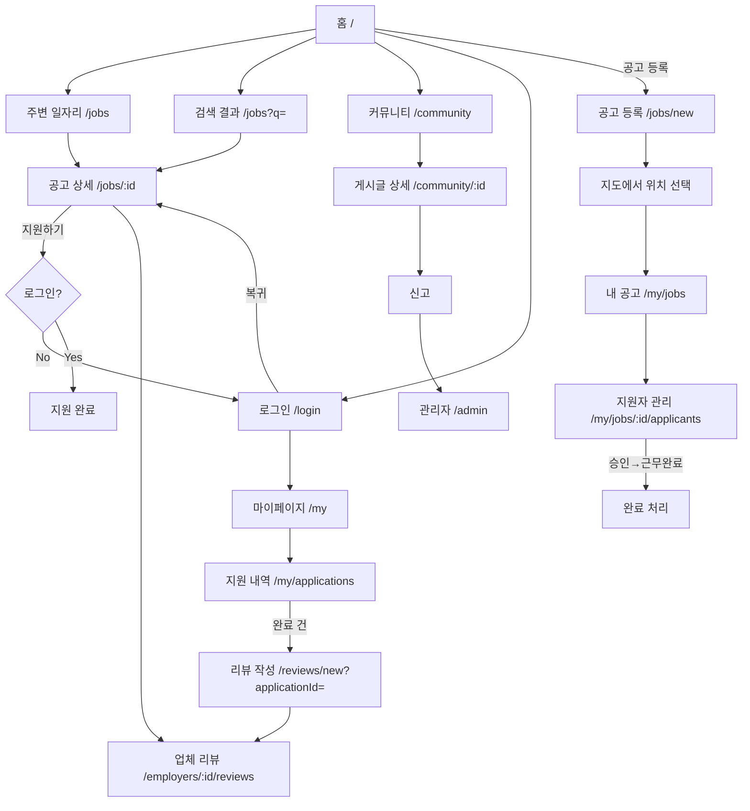
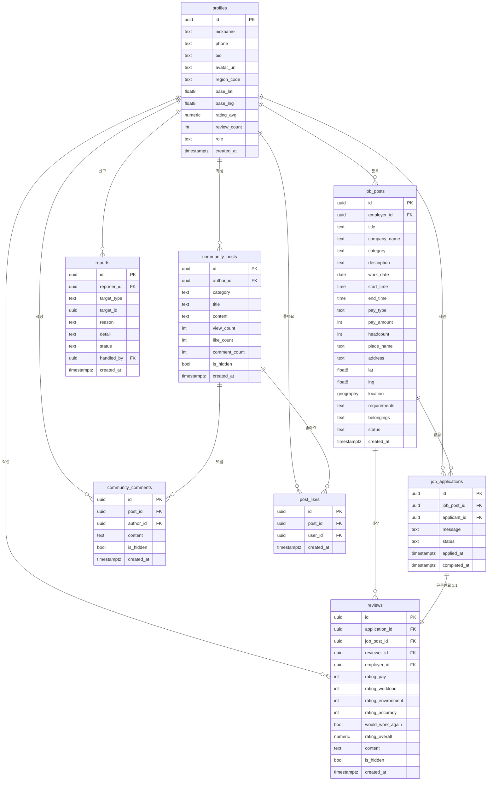

# HARU — 1차 설계 문서 (아키텍처 · 요구사항 · DB · 공통 타입)

> 내 주변의 하루 일자리, 믿을 수 있는 후기와 함께
> 문서 버전 v1.0 / 작성일 2026-10-16 / 범위: 1단계 설계 확정 (코드 생성 전)

---

## 0. 기술 결정 요약

| 항목 | 결정 | 비고 |
|---|---|---|
| 프론트엔드 | React 18 + TypeScript + Vite + Tailwind CSS + React Router v6 | |
| 아이콘 | lucide-react | 경량, 트리셰이킹 지원 |
| 백엔드/DB | Supabase (PostgreSQL 15+, Auth, Storage) | |
| 지도 | **자체 구현 `HaruMap`** (외부 지도 API 미사용) | 행정동 경계 GeoJSON을 빌드 타임에 정적 포함 |
| 지오코딩 | 미지원 → **지도 클릭으로 좌표 지정** | 외부 의존 0 |
| 거리 계산 | PostGIS `geography(Point,4326)` + `<->` 연산자 + RPC | 폴백: Haversine SQL 함수 |
| 상태 관리 | React Context (auth) + TanStack Query (서버 상태) | 전역 스토어 미도입 |
| 배포 | Vercel (프론트) + Supabase (백엔드) | |

### 임의로 세운 가정 (이견 시 지적 필요)
1. 하나의 계정이 구직자·구인자 역할을 동시에 보유한다. 별도 역할 선택 화면 없음. 관리자만 `profiles.role`로 분리.
2. "업체"는 독립 테이블이 아니라 **구인자 계정(`employer_id`)** 을 단위로 한다. 평균 평점은 구인자 프로필에 집계 컬럼으로 캐시한다.
3. 급여는 원화 정수(KRW)로만 저장하며 소수점을 쓰지 않는다.
4. 근무일은 단일 날짜(`work_date`) + 시작/종료 시각이다. 다일(多日) 근무는 1단계 범위 밖.
5. 샘플 데이터는 서울특별시 강서구 일대를 중심으로 생성한다.

### 오류 가능 지점 (사전 식별)
| # | 지점 | 영향 | 대응 |
|---|---|---|---|
| E1 | `location` 생성 컬럼(GENERATED ALWAYS AS)이 PostGIS 캐스팅 immutability 문제로 거부될 수 있음 | 마이그레이션 실패 | 실패 시 BEFORE INSERT/UPDATE 트리거 방식으로 전환 (SQL 동봉) |
| E2 | `profiles.role`을 사용자가 스스로 'admin'으로 UPDATE | 권한 탈취 | 컬럼 변경 감지 트리거로 차단 (RLS만으로는 불충분) |
| E3 | 개발용 "근무 완료 처리" 기능이 운영에 잔존 | 리뷰 신뢰도 붕괴 | `VITE_ENABLE_DEV_TOOLS` 플래그 + 해당 RPC를 `service_role` 전용으로 분리 |
| E4 | 중복 지원이 프론트 검증만으로 막힘 | 데이터 오염 | `UNIQUE(job_post_id, applicant_id)` 제약 (DB 레벨) |
| E5 | Supabase 무료 프로젝트 비활성화 | 발표 당일 시연 불가 | 4주차 체크리스트에 "발표 전날 활성 상태 확인" 포함 |

---

## 1. 요구사항 명세서

### 1.1 기능 요구사항

구분: **C**(핵심, 1~3주차 필수) / **S**(준핵심, 3주차) / **O**(선택, 4주차 여유 시)

#### 회원·인증 (AUTH)
| ID | 요구사항 | 구분 | 완료 기준 |
|---|---|---|---|
| AUTH-01 | 이메일·비밀번호 회원가입 | C | 가입 시 `profiles` 행이 트리거로 자동 생성됨 |
| AUTH-02 | 로그인 / 로그아웃 / 세션 유지 | C | 새로고침 후에도 로그인 상태 유지 |
| AUTH-03 | 프로필 조회·수정 (닉네임, 연락처, 한줄소개, 프로필 이미지) | C | 저장 후 재조회 시 반영 |
| AUTH-04 | 활동 지역 설정 (시/군/구 단위 + 기준 좌표) | C | 위치 권한 거부 시에도 지역 선택으로 탐색 가능 |
| AUTH-05 | 비로그인 상태에서 보호된 라우트 접근 시 로그인 유도 | C | `/jobs/new` 등 접근 시 로그인 페이지로 리다이렉트 + 복귀 |
| AUTH-06 | 회원 탈퇴 | O | |

#### 위치 기반 탐색 (MAP)
| ID | 요구사항 | 구분 | 완료 기준 |
|---|---|---|---|
| MAP-01 | 브라우저 Geolocation으로 현재 위치 획득 | C | 거부 시 기본 지역으로 폴백, 오류 메시지 노출 |
| MAP-02 | 지역 직접 선택 (시도 → 시군구) | C | 선택 지역 중심 좌표로 재조회 |
| MAP-03 | 자체 지도에 공고 마커 표시 + 클러스터링 | C | 마커 클릭 시 공고 요약 카드 노출 |
| MAP-04 | 지도/목록 동시 제공 및 토글 | C | 모바일에서 탭 전환, PC에서 좌우 분할 |
| MAP-05 | 반경 설정 (1/3/5/10km) | C | 반경 원이 지도에 표시되고 결과 수가 변함 |
| MAP-06 | 정렬: 거리순 / 급여순 / 최신순 | C | 거리순은 DB가 계산한 `distance_m` 기준 |
| MAP-07 | 필터: 직종, 근무 날짜(오늘/내일/직접선택), 급여 유형, 최소 급여 | C | 필터 조합이 URL 쿼리에 반영되어 공유 가능 |
| MAP-08 | 공고 카드: 제목, 업체명, 급여, 근무시간, 거리, 평점 | C | 평점 없는 업체는 "후기 없음" 표기 |
| MAP-09 | 키워드 검색 (제목·업무내용) | C | |
| MAP-10 | 지역별 공고 수 히트맵 | O | |

#### 공고 관리 (JOB)
| ID | 요구사항 | 구분 | 완료 기준 |
|---|---|---|---|
| JOB-01 | 공고 등록 (제목, 업체명, 직종, 업무내용, 근무일, 시작·종료시각, 급여유형, 급여액, 모집인원, 근무장소명, 좌표, 지원자격, 준비물) | C | 지도 클릭으로 좌표 지정 필수 |
| JOB-02 | 공고 수정 / 삭제 | C | 작성자 본인만 가능 (RLS로 검증) |
| JOB-03 | 모집 마감 처리 | C | 마감 공고는 목록에서 제외, 상세는 조회 가능 |
| JOB-04 | 공고 상세 조회 | C | 비로그인도 조회 가능 |
| JOB-05 | 공고 이미지 업로드 | O | Supabase Storage |

#### 지원·채용 (APP)
| ID | 요구사항 | 구분 | 완료 기준 |
|---|---|---|---|
| APP-01 | 공고 지원 | C | 본인 공고 지원 불가, 마감 공고 지원 불가 |
| APP-02 | 중복 지원 방지 | C | DB UNIQUE 제약으로 차단, UI는 "지원 완료" 표시 |
| APP-03 | 지원 취소 | C | `pending` 상태에서만 가능 |
| APP-04 | 지원자 목록 조회 (구인자) | C | 타인 공고의 지원자는 조회 불가 |
| APP-05 | 승인 / 거절 | C | 상태 변경이 구직자 마이페이지에 즉시 반영 |
| APP-06 | 근무 완료 처리 (구인자) | C | `accepted` → `completed` 만 허용 |
| APP-07 | 모집 인원 충족 시 자동 마감 안내 | O | |

#### 리뷰 (REV)
| ID | 요구사항 | 구분 | 완료 기준 |
|---|---|---|---|
| REV-01 | 근무 완료자만 리뷰 작성 | C | **DB RLS에서 검증** (프론트 숨김만으로 불가) |
| REV-02 | 지원 건당 리뷰 1회 | C | `UNIQUE(application_id)` |
| REV-03 | 세부 평가 5항목 (급여지급, 업무강도, 근무환경, 공고일치도, 재근무의향) + 총점 | C | 각 1~5 정수, 재근무의향은 boolean |
| REV-04 | 업체(구인자)별 평균 평점·리뷰 수 | C | 트리거로 `profiles`에 집계 캐시 |
| REV-05 | 리뷰 수정 / 삭제 | C | 본인만 |
| REV-06 | 리뷰 신고 | S | |
| REV-07 | 공고 상세·공고 카드에 평점 노출 | C | |

#### 커뮤니티 (COM)
| ID | 요구사항 | 구분 | 완료 기준 |
|---|---|---|---|
| COM-01 | 게시글 CRUD (카테고리: 후기/정보/자유/주의) | S | |
| COM-02 | 댓글 CRUD | S | |
| COM-03 | 좋아요 토글 | O | `UNIQUE(post_id, user_id)` |
| COM-04 | 카테고리 필터 + 최신순 정렬 | S | |
| COM-05 | 게시글 검색 | O | |
| COM-06 | 게시글·댓글 신고 | S | |

#### 마이페이지 (MY)
| ID | 요구사항 | 구분 |
|---|---|---|
| MY-01 | 프로필 관리 | C |
| MY-02 | 내가 등록한 공고 + 상태별 필터 | C |
| MY-03 | 내가 지원한 공고 + 상태별 필터 | C |
| MY-04 | 내가 쓴 리뷰 / 작성 가능한 리뷰 목록 | C |
| MY-05 | 내가 쓴 게시글·댓글 | S |

#### 관리자 (ADM)
| ID | 요구사항 | 구분 |
|---|---|---|
| ADM-01 | 신고 목록 조회 및 처리(승인/반려) | S |
| ADM-02 | 게시글·리뷰 숨김 처리 | S |
| ADM-03 | 공고 숨김 처리 | O |
| ADM-04 | 관리자 권한 상승 차단 (트리거) | C |

### 1.2 비기능 요구사항
- **반응형**: 360px(모바일) / 768px(태블릿) / 1280px(PC) 세 지점에서 레이아웃 깨짐 없음. 모바일 우선 설계.
- **성능**: 공고 목록 첫 렌더 1.5초 이내(샘플 300건 기준). 근접 검색 쿼리는 공간 인덱스 사용.
- **보안**: 모든 테이블 RLS 활성화. 익명 키(anon key)만 클라이언트 노출. `service_role` 키는 클라이언트 번들에 절대 포함 금지.
- **접근성**: 모든 인터랙티브 요소에 접근 가능한 이름 부여, 포커스 표시 유지.
- **정직성**: 결제·급여 지급·실시간 알림은 구현하지 않으며, UI에 구현된 것처럼 표시하지 않는다.

---

## 2. 사용자 역할 및 권한 매트릭스

| 리소스 | 비로그인 | 로그인 사용자 | 작성자 본인 | 구인자(해당 공고) | 관리자 |
|---|---|---|---|---|---|
| 공고 목록·상세 조회 | O | O | O | O | O |
| 공고 등록 | X | O | — | — | O |
| 공고 수정·삭제·마감 | X | X | O | O | O |
| 지원하기 | X | O | X(본인 공고) | — | O |
| 지원자 목록 조회 | X | X | — | O | O |
| 지원 상태 변경(승인/거절/완료) | X | X | — | O | O |
| 지원 취소 | X | X | O | X | O |
| 리뷰 작성 | X | X(완료 이력 없으면) | O(완료자) | X | X |
| 리뷰 조회 | O | O | O | O | O |
| 커뮤니티 글 작성 | X | O | — | — | O |
| 신고 접수 | X | O | — | — | O |
| 신고 처리 | X | X | X | X | O |

---

## 3. 사용자 시나리오

### S1. 구직자 — 내일 할 일 찾기
1. 홈 진입 → 위치 권한 허용 → "내 주변 일자리" 섹션에 거리순 공고 노출
2. 상단 필터에서 `내일` + `물류·상하차` 선택, 반경 5km
3. 지도에서 마커 클릭 → 요약 카드 → 상세 진입
4. 상세에서 업체 평균 평점 4.2 / 리뷰 12건 확인, 리뷰 탭에서 "급여 지급" 항목 평점 확인
5. `지원하기` → 로그인 필요 → 로그인 후 원래 공고로 복귀 → 지원 완료
6. 마이페이지 → 지원한 공고 → 상태 `대기중`

### S2. 구인자 — 공고 등록부터 채용까지
1. 홈 우하단 `공고 등록` → 폼 입력 → **지도에서 근무 위치 클릭** → 등록
2. 마이페이지 → 등록한 공고 → 지원자 3명 확인
3. 지원자 프로필·평점 확인 후 2명 `승인`, 1명 `거절`
4. 모집 인원 충족 → `모집 마감`
5. 근무일 이후 → 승인자 각각 `근무 완료` 처리

### S3. 근무자 — 리뷰 작성
1. 마이페이지 → "작성 가능한 리뷰" 배지 노출 (완료 상태인데 리뷰 미작성)
2. 리뷰 작성 → 5개 세부 항목 별점 + 재근무 의향 + 상세 후기
3. 저장 → 해당 업체 평균 평점 즉시 갱신 → 다른 사용자가 공고 카드에서 확인

### S4. 관리자 — 신고 처리
1. `/admin` 접근 (role=admin 아니면 403 화면)
2. 신고 목록 → 대상 콘텐츠 원문 확인 → `숨김 처리` 또는 `반려`

---

## 4. 화면 이동 흐름



---

## 5. 사이트맵 · 라우트 정의

| 경로 | 화면 | 인증 | 비고 |
|---|---|---|---|
| `/` | 메인 홈 | 불필요 | 지역선택, 검색창, 카테고리, 추천/주변 공고, 최근 후기, 커뮤니티 최신글 |
| `/jobs` | 주변 일자리 (지도+목록) | 불필요 | 필터·정렬 상태를 쿼리스트링으로 보존 |
| `/jobs/:id` | 공고 상세 | 불필요 | 지원 버튼은 인증 게이트 |
| `/jobs/new` | 공고 등록 | 필요 | |
| `/jobs/:id/edit` | 공고 수정 | 필요(작성자) | |
| `/employers/:id/reviews` | 업체 리뷰 목록 | 불필요 | |
| `/reviews/new` | 리뷰 작성 | 필요(완료자) | `?applicationId=` |
| `/community` | 커뮤니티 목록 | 불필요 | |
| `/community/:id` | 게시글 상세 | 불필요 | |
| `/community/new` | 글 작성 | 필요 | |
| `/login`, `/signup` | 인증 | 불필요 | |
| `/my` | 마이페이지 대시보드 | 필요 | |
| `/my/profile` | 프로필 수정 | 필요 | |
| `/my/jobs` | 등록한 공고 | 필요 | |
| `/my/jobs/:id/applicants` | 지원자 관리 | 필요(작성자) | |
| `/my/applications` | 지원 내역 | 필요 | |
| `/my/reviews` | 작성한/가능한 리뷰 | 필요 | |
| `/admin` | 관리자 | 필요(admin) | |

---

## 6. 상태값 규약 (팀 전체 통일 — 임의 변경 금지)

```ts
// src/types/enums.ts
export const JOB_STATUS = ['open', 'closed', 'hidden'] as const;
export const APPLICATION_STATUS = ['pending', 'accepted', 'rejected', 'cancelled', 'completed'] as const;
export const PAY_TYPE = ['hourly', 'daily'] as const;
export const JOB_CATEGORY = [
  'serving', 'kitchen', 'cafe', 'delivery', 'logistics',
  'construction', 'event', 'mart', 'cleaning', 'office', 'etc',
] as const;
export const COMMUNITY_CATEGORY = ['review', 'info', 'free', 'caution'] as const;
export const REPORT_TARGET = ['job_post', 'review', 'community_post', 'community_comment'] as const;
export const REPORT_STATUS = ['pending', 'resolved', 'rejected'] as const;
export const USER_ROLE = ['user', 'admin'] as const;
```

| 값 | 한국어 라벨 | 의미 |
|---|---|---|
| `pending` | 대기중 | 지원했고 구인자 응답 전 |
| `accepted` | 승인됨 | 채용 확정, 근무 예정 |
| `rejected` | 거절됨 | 구인자가 거절 |
| `cancelled` | 취소됨 | 구직자가 철회 |
| `completed` | 근무완료 | **리뷰 작성 권한 발생 시점** |

상태 전이 규칙:
```
pending --구인자--> accepted | rejected
pending --구직자--> cancelled
accepted --구인자--> completed
completed --> (종료, 변경 불가)
```

---

## 7. 데이터베이스 설계

### 7.1 ERD



### 7.2 테이블 상세 정의

#### profiles
| 컬럼 | 타입 | NULL | 기본값 | 제약·설명 |
|---|---|---|---|---|
| id | uuid | N | — | PK, FK → `auth.users(id)` ON DELETE CASCADE |
| nickname | text | N | — | 2~12자, UNIQUE |
| phone | text | Y | — | |
| bio | text | Y | — | 최대 200자 |
| avatar_url | text | Y | — | Storage 경로 |
| region_code | text | Y | — | 행정구역 코드(시군구 5자리) |
| base_lat / base_lng | float8 | Y | — | 활동 지역 기준 좌표 |
| rating_avg | numeric(3,2) | N | 0 | 구인자로서 받은 평균 평점(트리거 갱신) |
| review_count | int | N | 0 | 트리거 갱신 |
| role | text | N | `'user'` | CHECK IN ('user','admin') |
| created_at | timestamptz | N | now() | |

인덱스: `idx_profiles_role (role)`

#### job_posts
| 컬럼 | 타입 | NULL | 기본값 | 제약·설명 |
|---|---|---|---|---|
| id | uuid | N | gen_random_uuid() | PK |
| employer_id | uuid | N | — | FK → profiles(id) ON DELETE CASCADE |
| title | text | N | — | 5~60자 |
| company_name | text | N | — | |
| category | text | N | — | CHECK IN (JOB_CATEGORY) |
| description | text | N | — | |
| work_date | date | N | — | CHECK ≥ 등록일 (수정 시 예외) |
| start_time / end_time | time | N | — | |
| pay_type | text | N | `'hourly'` | CHECK IN ('hourly','daily') |
| pay_amount | int | N | — | CHECK > 0 |
| headcount | int | N | 1 | CHECK ≥ 1 |
| place_name | text | N | — | 예: "마곡나루역 3번 출구 앞 물류센터" |
| address | text | Y | — | 사용자 직접 입력 |
| lat / lng | float8 | N | — | 지도 클릭으로 지정 |
| location | geography(Point,4326) | N | 생성값 | `ST_SetSRID(ST_MakePoint(lng,lat),4326)::geography` |
| requirements | text | Y | — | 지원 자격 |
| belongings | text | Y | — | 준비물 |
| status | text | N | `'open'` | CHECK IN ('open','closed','hidden') |
| created_at / updated_at | timestamptz | N | now() | |

인덱스:
- `idx_job_posts_location` **GIST(location)** — 근접 검색 핵심
- `idx_job_posts_work_date (work_date)`
- `idx_job_posts_status_date (status, work_date)`
- `idx_job_posts_employer (employer_id)`
- `idx_job_posts_category (category)`

#### job_applications
| 컬럼 | 타입 | NULL | 기본값 | 제약·설명 |
|---|---|---|---|---|
| id | uuid | N | gen_random_uuid() | PK |
| job_post_id | uuid | N | — | FK → job_posts(id) ON DELETE CASCADE |
| applicant_id | uuid | N | — | FK → profiles(id) ON DELETE CASCADE |
| message | text | Y | — | 지원 메시지 |
| status | text | N | `'pending'` | CHECK IN (APPLICATION_STATUS) |
| applied_at | timestamptz | N | now() | |
| completed_at | timestamptz | Y | — | `completed` 전환 시 기록 |

제약: **`UNIQUE (job_post_id, applicant_id)`** ← 중복 지원 차단의 유일한 신뢰 지점
인덱스: `idx_applications_applicant (applicant_id, status)`, `idx_applications_job (job_post_id, status)`

#### reviews
| 컬럼 | 타입 | NULL | 기본값 | 제약·설명 |
|---|---|---|---|---|
| id | uuid | N | gen_random_uuid() | PK |
| application_id | uuid | N | — | FK → job_applications(id), **UNIQUE** (1지원=1리뷰) |
| job_post_id | uuid | N | — | FK → job_posts(id) |
| reviewer_id | uuid | N | — | FK → profiles(id) |
| employer_id | uuid | N | — | FK → profiles(id), 집계용 비정규화 |
| rating_pay | int | N | — | CHECK 1~5 (급여 지급) |
| rating_workload | int | N | — | CHECK 1~5 (업무 강도) |
| rating_environment | int | N | — | CHECK 1~5 (근무 환경) |
| rating_accuracy | int | N | — | CHECK 1~5 (공고-실제 일치도) |
| would_work_again | boolean | N | — | 재근무 의향 |
| rating_overall | numeric(3,2) | N | 생성값 | 4개 항목 평균 (GENERATED) |
| content | text | N | — | 10자 이상 |
| is_hidden | boolean | N | false | 관리자 숨김 |
| created_at / updated_at | timestamptz | N | now() | |

인덱스: `idx_reviews_employer (employer_id)`, `idx_reviews_job (job_post_id)`

#### community_posts / community_comments / post_likes / reports
| 테이블 | 핵심 제약 |
|---|---|
| community_posts | `category` CHECK IN (COMMUNITY_CATEGORY), `like_count`·`comment_count`는 트리거 갱신 |
| community_comments | FK post_id ON DELETE CASCADE |
| post_likes | **`UNIQUE (post_id, user_id)`** |
| reports | `target_type` CHECK IN (REPORT_TARGET), `UNIQUE (reporter_id, target_type, target_id)` (중복 신고 차단), `status` CHECK IN (REPORT_STATUS) |

> `reports.target_id`는 다형 참조이므로 FK를 걸 수 없다. 대신 `target_type`+`target_id` 조합을 애플리케이션 레벨에서 검증하고, 관리자 화면에서 원문 조회 시 타입별로 분기한다.

### 7.3 근접 검색 RPC

```sql
create or replace function public.search_jobs(
  p_lat        double precision,
  p_lng        double precision,
  p_radius_m   integer default 5000,
  p_category   text    default null,
  p_date_from  date    default null,
  p_date_to    date    default null,
  p_pay_type   text    default null,
  p_min_pay    integer default null,
  p_keyword    text    default null,
  p_sort       text    default 'distance',  -- distance | pay | recent
  p_limit      integer default 20,
  p_offset     integer default 0
)
returns table (
  id uuid, title text, company_name text, category text,
  work_date date, start_time time, end_time time,
  pay_type text, pay_amount integer, headcount integer,
  place_name text, lat double precision, lng double precision,
  employer_id uuid, rating_avg numeric, review_count integer,
  distance_m double precision, created_at timestamptz
)
language sql stable security invoker
as $$
  select j.id, j.title, j.company_name, j.category,
         j.work_date, j.start_time, j.end_time,
         j.pay_type, j.pay_amount, j.headcount,
         j.place_name, j.lat, j.lng,
         j.employer_id, p.rating_avg, p.review_count,
         st_distance(j.location, st_setsrid(st_makepoint(p_lng, p_lat), 4326)::geography) as distance_m,
         j.created_at
  from public.job_posts j
  join public.profiles p on p.id = j.employer_id
  where j.status = 'open'
    and st_dwithin(j.location, st_setsrid(st_makepoint(p_lng, p_lat), 4326)::geography, p_radius_m)
    and (p_category  is null or j.category = p_category)
    and (p_date_from is null or j.work_date >= p_date_from)
    and (p_date_to   is null or j.work_date <= p_date_to)
    and (p_pay_type  is null or j.pay_type = p_pay_type)
    and (p_min_pay   is null or j.pay_amount >= p_min_pay)
    and (p_keyword   is null or j.title ilike '%' || p_keyword || '%'
                             or j.description ilike '%' || p_keyword || '%')
  order by
    case when p_sort = 'distance' then st_distance(j.location, st_setsrid(st_makepoint(p_lng, p_lat), 4326)::geography) end asc,
    case when p_sort = 'pay' then j.pay_amount end desc,
    case when p_sort = 'recent' then extract(epoch from j.created_at) end desc
  limit p_limit offset p_offset;
$$;
```

> `security invoker`이므로 RLS가 그대로 적용된다. `security definer`를 쓰면 RLS가 우회되므로 사용하지 않는다.

### 7.4 RLS 정책 방향

전 테이블 `alter table ... enable row level security;` 적용 후:

| 테이블 | SELECT | INSERT | UPDATE | DELETE |
|---|---|---|---|---|
| profiles | 전체 허용 | 트리거 자동 생성 | `auth.uid() = id` (role 변경은 트리거 차단) | 금지 |
| job_posts | `status <> 'hidden'` 또는 본인 또는 admin | `auth.uid() = employer_id` | 본인 또는 admin | 본인 또는 admin |
| job_applications | 본인(`applicant_id`) 또는 해당 공고 구인자 또는 admin | `auth.uid() = applicant_id` AND 본인 공고 아님 AND 공고 `status='open'` | 구직자는 `cancelled`로만, 구인자는 `accepted/rejected/completed`로만 | 금지 |
| reviews | `is_hidden = false` 또는 본인 또는 admin | **아래 핵심 정책** | 본인 | 본인 또는 admin |
| community_* | `is_hidden = false` 또는 admin | 로그인 사용자 | 본인 | 본인 또는 admin |
| post_likes | 전체 | 본인 | — | 본인 |
| reports | 본인 또는 admin | 로그인 사용자 | admin만 | 금지 |

**핵심 정책 — 리뷰 작성 권한 (REV-01)**

```sql
create policy "review_insert_completed_only"
on public.reviews for insert to authenticated
with check (
  auth.uid() = reviewer_id
  and exists (
    select 1
    from public.job_applications a
    where a.id = application_id
      and a.applicant_id = auth.uid()
      and a.status = 'completed'
      and a.job_post_id = reviews.job_post_id
  )
);
```

**관리자 권한 상승 차단 (E2)**

```sql
create or replace function public.prevent_role_escalation()
returns trigger language plpgsql security definer as $$
begin
  if new.role is distinct from old.role then
    if not exists (select 1 from public.profiles where id = auth.uid() and role = 'admin') then
      raise exception 'role 변경 권한이 없습니다';
    end if;
  end if;
  return new;
end; $$;

create trigger trg_prevent_role_escalation
before update on public.profiles
for each row execute function public.prevent_role_escalation();
```

**개발용 근무 완료 처리 (E3)**: `dev_complete_application(p_id uuid)` RPC를 별도 마이그레이션 파일(`999_dev_only.sql`)로 분리하고, 배포 전 DROP 하는 절차를 체크리스트에 포함한다.

---

## 8. HaruMap — 자체 지도 설계

### 8.1 구조
```
src/components/map/
  HaruMap.tsx          # 컨테이너. SVG 캔버스 + 이벤트 제어
  projection.ts        # 위경도 ↔ 화면 좌표 변환 (Web Mercator)
  useMapViewport.ts    # center, zoom, 드래그/휠 처리
  BoundaryLayer.tsx    # 행정동 경계 GeoJSON → <path>
  MarkerLayer.tsx      # 공고 마커 + 클러스터
  RadiusCircle.tsx     # 반경 원
  LocationPicker.tsx   # 공고 등록용 좌표 선택 모드
public/geo/
  seoul-gangseo.geojson  # 빌드 타임에 단순화해 포함한 경계 데이터
```

### 8.2 좌표 변환 (Web Mercator)
```ts
export function project(lat: number, lng: number, zoom: number) {
  const scale = 256 * 2 ** zoom;
  const x = ((lng + 180) / 360) * scale;
  const sinLat = Math.sin((lat * Math.PI) / 180);
  const y = (0.5 - Math.log((1 + sinLat) / (1 - sinLat)) / (4 * Math.PI)) * scale;
  return { x, y };
}
```
역변환 `unproject()`를 함께 제공해 지도 클릭 → 좌표 획득을 구현한다.

### 8.3 경계 데이터 준비 절차
1. 행정동 경계 GeoJSON(WGS84, EPSG:4326) 원본 확보
2. `mapshaper`로 대상 지역만 추출 + 좌표 정밀도 축소(-simplify 5%) → 파일 크기 100KB 이하 목표
3. `public/geo/`에 정적 포함 → **런타임 외부 요청 0**
4. 출처 표기를 푸터에 명시 (공공저작물 출처표시 라이선스 준수)

### 8.4 한계와 대응
| 한계 | 대응 |
|---|---|
| 도로·건물 없음 | 경계선 + 장소명 라벨 + 마커로 정보 보완, 디자인을 '일러스트 지도' 톤으로 통일 |
| 주소→좌표 변환 불가 | 공고 등록 시 지도 클릭 필수. 주소는 보조 텍스트로만 입력 |
| 고배율 확대 시 정보 부족 | 최대 줌을 16으로 제한 |

---

## 9. 공통 TypeScript 타입

```ts
// src/types/database.ts
import type { JOB_STATUS, APPLICATION_STATUS, PAY_TYPE, JOB_CATEGORY,
              COMMUNITY_CATEGORY, REPORT_TARGET, REPORT_STATUS, USER_ROLE } from './enums';

export type JobStatus         = (typeof JOB_STATUS)[number];
export type ApplicationStatus = (typeof APPLICATION_STATUS)[number];
export type PayType           = (typeof PAY_TYPE)[number];
export type JobCategory       = (typeof JOB_CATEGORY)[number];
export type CommunityCategory = (typeof COMMUNITY_CATEGORY)[number];
export type ReportTarget      = (typeof REPORT_TARGET)[number];
export type ReportStatus      = (typeof REPORT_STATUS)[number];
export type UserRole          = (typeof USER_ROLE)[number];

export interface Profile {
  id: string;
  nickname: string;
  phone: string | null;
  bio: string | null;
  avatarUrl: string | null;
  regionCode: string | null;
  baseLat: number | null;
  baseLng: number | null;
  ratingAvg: number;
  reviewCount: number;
  role: UserRole;
  createdAt: string;
}

export interface JobPost {
  id: string;
  employerId: string;
  title: string;
  companyName: string;
  category: JobCategory;
  description: string;
  workDate: string;        // 'YYYY-MM-DD'
  startTime: string;       // 'HH:mm'
  endTime: string;
  payType: PayType;
  payAmount: number;       // KRW, 정수
  headcount: number;
  placeName: string;
  address: string | null;
  lat: number;
  lng: number;
  requirements: string | null;
  belongings: string | null;
  status: JobStatus;
  createdAt: string;
  updatedAt: string;
}

/** 목록·지도에서 사용하는 조회 전용 확장 타입 */
export interface JobPostSummary extends Pick<JobPost,
  'id'|'title'|'companyName'|'category'|'workDate'|'startTime'|'endTime'|
  'payType'|'payAmount'|'headcount'|'placeName'|'lat'|'lng'|'employerId'|'createdAt'> {
  distanceM: number;       // DB가 계산한 값. 클라이언트에서 재계산 금지
  ratingAvg: number;
  reviewCount: number;
}

export interface JobApplication {
  id: string;
  jobPostId: string;
  applicantId: string;
  message: string | null;
  status: ApplicationStatus;
  appliedAt: string;
  completedAt: string | null;
}

export interface JobApplicationWithRelations extends JobApplication {
  jobPost: Pick<JobPost, 'id'|'title'|'companyName'|'workDate'|'payType'|'payAmount'|'placeName'>;
  applicant: Pick<Profile, 'id'|'nickname'|'avatarUrl'|'ratingAvg'>;
  hasReview: boolean;
}

export interface Review {
  id: string;
  applicationId: string;
  jobPostId: string;
  reviewerId: string;
  employerId: string;
  ratingPay: number;
  ratingWorkload: number;
  ratingEnvironment: number;
  ratingAccuracy: number;
  wouldWorkAgain: boolean;
  ratingOverall: number;
  content: string;
  isHidden: boolean;
  createdAt: string;
  updatedAt: string;
}

export interface ReviewWithAuthor extends Review {
  reviewer: Pick<Profile, 'id'|'nickname'|'avatarUrl'>;
  jobTitle: string;
}

export interface EmployerRatingSummary {
  employerId: string;
  companyName: string;
  ratingAvg: number;
  reviewCount: number;
  breakdown: { pay: number; workload: number; environment: number; accuracy: number };
  wouldWorkAgainRate: number;  // 0~1
}

export interface CommunityPost {
  id: string;
  authorId: string;
  category: CommunityCategory;
  title: string;
  content: string;
  viewCount: number;
  likeCount: number;
  commentCount: number;
  isHidden: boolean;
  createdAt: string;
  updatedAt: string;
}

export interface CommunityComment {
  id: string;
  postId: string;
  authorId: string;
  content: string;
  isHidden: boolean;
  createdAt: string;
}

export interface Report {
  id: string;
  reporterId: string;
  targetType: ReportTarget;
  targetId: string;
  reason: string;
  detail: string | null;
  status: ReportStatus;
  handledBy: string | null;
  createdAt: string;
}
```

> **네이밍 규칙**: DB는 `snake_case`, 애플리케이션은 `camelCase`. 변환은 `src/lib/mappers.ts`의 매퍼 함수에서만 수행하고, 컴포넌트에 snake_case가 새어나가지 않게 한다.

---

## 10. 서비스 함수 규격

모든 Supabase 호출은 `src/services/*.ts`를 통해서만 이뤄진다. 컴포넌트에서 `supabase.from(...)` 직접 호출 금지.

공통 결과 타입:
```ts
export type Result<T> = { data: T; error: null } | { data: null; error: ServiceError };
export interface ServiceError { code: string; message: string; cause?: unknown }
```

| 함수 | 시그니처 | 인증 | 권한 | 주요 오류 코드 |
|---|---|---|---|---|
| `getNearbyJobs` | `(params: NearbyJobsParams) => Promise<Result<JobPostSummary[]>>` | 불필요 | — | `LOCATION_REQUIRED` |
| `getJobDetail` | `(id: string) => Promise<Result<JobPostDetail>>` | 불필요 | — | `NOT_FOUND` |
| `createJob` | `(input: CreateJobInput) => Promise<Result<JobPost>>` | 필요 | 로그인 사용자 | `VALIDATION_FAILED`, `UNAUTHENTICATED` |
| `updateJob` | `(id: string, input: UpdateJobInput) => Promise<Result<JobPost>>` | 필요 | 작성자 | `FORBIDDEN` |
| `deleteJob` | `(id: string) => Promise<Result<void>>` | 필요 | 작성자 | `FORBIDDEN` |
| `closeJob` | `(id: string) => Promise<Result<JobPost>>` | 필요 | 작성자 | `INVALID_STATE` |
| `applyToJob` | `(jobId: string, message?: string) => Promise<Result<JobApplication>>` | 필요 | 본인 공고 아님 | `DUPLICATE_APPLICATION`, `JOB_CLOSED`, `SELF_APPLY` |
| `cancelApplication` | `(id: string) => Promise<Result<JobApplication>>` | 필요 | 지원자 본인 | `INVALID_STATE` |
| `getApplicants` | `(jobId: string) => Promise<Result<JobApplicationWithRelations[]>>` | 필요 | 공고 작성자 | `FORBIDDEN` |
| `getMyApplications` | `(status?: ApplicationStatus) => Promise<Result<JobApplicationWithRelations[]>>` | 필요 | 본인 | |
| `updateApplicationStatus` | `(id: string, status: ApplicationStatus) => Promise<Result<JobApplication>>` | 필요 | 구인자/구직자(전이규칙) | `INVALID_TRANSITION`, `FORBIDDEN` |
| `getJobReviews` | `(jobId: string) => Promise<Result<ReviewWithAuthor[]>>` | 불필요 | — | |
| `getEmployerReviews` | `(employerId: string, page?: number) => Promise<Result<ReviewWithAuthor[]>>` | 불필요 | — | |
| `getEmployerRating` | `(employerId: string) => Promise<Result<EmployerRatingSummary>>` | 불필요 | — | |
| `getReviewableApplications` | `() => Promise<Result<JobApplicationWithRelations[]>>` | 필요 | 본인 | |
| `createReview` | `(input: CreateReviewInput) => Promise<Result<Review>>` | 필요 | **완료 상태 지원자만(RLS)** | `NOT_COMPLETED`, `DUPLICATE_REVIEW` |
| `updateReview` / `deleteReview` | `(id, ...) => Promise<Result<...>>` | 필요 | 작성자 | `FORBIDDEN` |
| `getCommunityPosts` | `(params: { category?, keyword?, page? }) => Promise<Result<CommunityPost[]>>` | 불필요 | — | |
| `createCommunityPost` | `(input: CreatePostInput) => Promise<Result<CommunityPost>>` | 필요 | 로그인 | |
| `toggleLike` | `(postId: string) => Promise<Result<{ liked: boolean; likeCount: number }>>` | 필요 | 로그인 | |
| `createReport` | `(input: CreateReportInput) => Promise<Result<Report>>` | 필요 | 로그인 | `DUPLICATE_REPORT` |
| `getReports` / `handleReport` | — | 필요 | admin | `FORBIDDEN` |

```ts
export interface NearbyJobsParams {
  lat: number; lng: number;
  radiusM?: number;                 // 기본 5000
  category?: JobCategory;
  dateFrom?: string; dateTo?: string;
  payType?: PayType; minPay?: number;
  keyword?: string;
  sort?: 'distance' | 'pay' | 'recent';   // 기본 'distance'
  page?: number; pageSize?: number;       // 기본 1, 20
}
```

---

## 11. 다음 단계 (2차 문서에서 다룸)
1. 전체 폴더 구조 및 파일 단위 책임
2. 4인 역할 분담표 (담당 화면·파일·테이블·인터페이스·테스트 기준)
3. Git 브랜치 전략 / 커밋·PR 규칙 / 충돌 해결 절차
4. 4주 개발 일정 및 주차별 완료 기준
5. 실행 방법, `.env.example`, 배포 절차
6. 기능별 테스트 시나리오 및 발표 시연 순서

이후 3단계에서 실제 코드 생성(프로젝트 스캐폴딩 → 마이그레이션 SQL → 공통 기반 → 기능별 구현)에 착수한다.
